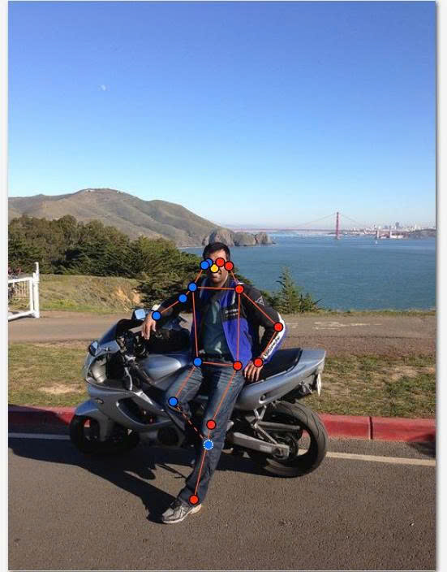
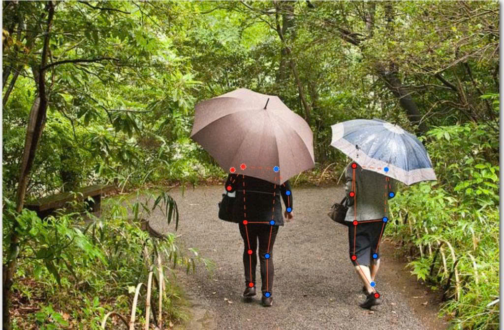
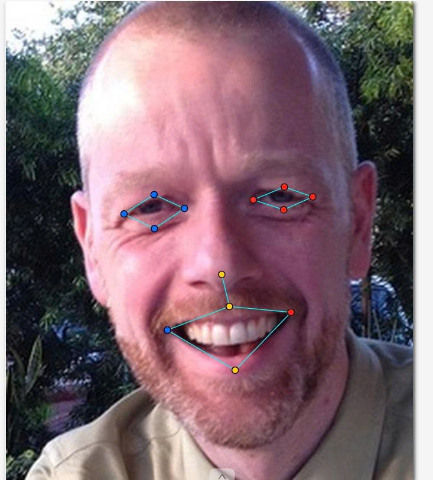
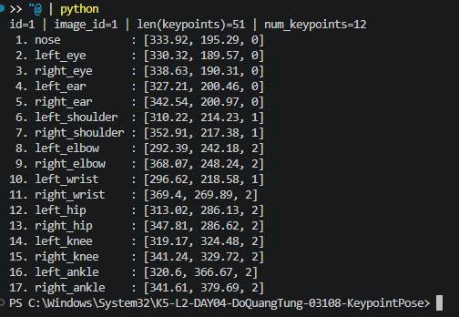

# Báo cáo cá nhân — DoQuangTung-2A202603108

Dữ liệu: 12 ảnh người COCO val2017 (Lin et al., 2014) và 8 ảnh chân dung Wikimedia Commons, chỉ dùng trong lớp.

## 0. Thông tin học viên

- Họ tên: Đỗ Quang Tùng
- MSSV: 2A202603108 
- Email: 26ai.tungdq@vinuni.edu.vn
- Link repository: https://github.com/dqtung1703/K5-L2-DAY04-DoQuangTung-03108-KeypointPose
- Phiên bản CVAT (Help → About): 2.74.1
- Máy: hệ điều hành Windows · RAM [Điền số GB RAM] 16GB · chạy CVAT chế độ đầy đủ
- Bộ ảnh (`src/exports/assignment.json` do `lab.py setup` tạo): có
- Giờ bắt đầu: [Điền giờ bắt đầu, ví dụ: 17:00] 16:20
- Giờ kết thúc: [Điền giờ kết thúc, ví dụ: 19:30] 19:10

## 1. Kiểm tra label (CP0)

| Label | Kiểu | Số điểm | Tên điểm đúng bảng của lab? | Đúng thứ tự? | Số cạnh |
|---|---|---:|---|---|---:|
| `person` | Skeleton | 17 | Có | Có | 19 |
| `face` | Skeleton | 13 | Có | Có | 13 |

Mẫu `person` dựng theo người quay mặt về camera (các điểm `left_*` nằm bên phải khung mẫu)? Có

Cách đổi cờ `occluded` / `outside` cho **một điểm** trên phiên bản CVAT này (một câu):

Nhấp chuột phải trực tiếp vào điểm keypoint cần chỉnh sửa trên khung vẽ (hoặc chọn điểm đó và dùng nút trạng thái trong bảng thuộc tính điểm bên phải) để bật cờ `Occluded` (`v = 1`) hoặc `Outside` (`v = 0`), tuyệt đối không dùng phím tắt `H` (`Hidden`) vì trạng thái ẩn chỉ hiển thị tạm trên giao diện và không được lưu lên server khi xuất file.

## 2. Số lượng đã gán và thời gian (CP1, CP2)

| Nhóm ảnh | Số ảnh | Số skeleton đã gán | Số người dưới 60 px (không gán) | Số poster / gương / màn hình bỏ qua | Thời gian (phút) |
|---|---:|---:|---:|---:|---:|
| `easy` | 5 | 7 | 0 | 0 | 35 |
| `occluded` | 3 | 5 | 0 | 0 | 30 |
| `back` | 2 | 3 | 0 | 0 | 25 |
| `small` | 1 | 1 | 2 | 0 | 15 |
| `crowd` | 1 | 4 | 5 | 0 | 25 |
| `faces` | 8 | 8 | — | 0 | 30 |

- Số ảnh người đã xong ở mốc phút 105: 10 / 10
- Thời gian thực tế (phút): CP1 65 · CP2 65 · CP3 30
- Ảnh tốn thời gian nhất là ảnh nào, vì sao?

Ảnh `000000130816.jpg` (nhóm crowd/occluded) và `000000054909.jpg` (nhóm back) tốn thời gian nhất vì phải xác định lại hướng trái/phải ngược với khung mẫu mặc định, kiểm tra ngưỡng chiều cao 60 px cho các nhân vật ở xa trên khán đài/sân và phân loại chính xác từng điểm bị vật thể hoặc người khác che khuất hoàn toàn (`v = 0`) so với bị che một phần (`v = 1`).

## 3. Bảng ca khó (CP1, CP2)

| Ảnh | Người / mặt | Điểm | Cờ đã chọn | Phân vân giữa | Lý do chọn |
|---|---|---|---:|---|---|
| `000000054909.jpg` | Người mặc áo đen bên trái & áo xám bên phải | `nose`, `left_eye`, `right_eye`, `left_ear`, `right_ear` | `0` (`outside`) | `v = 1` và `v = 0` | Tán ô che kín hoàn toàn phần đầu từ phía sau, không thể ước lượng chắc chắn vị trí từng bộ phận trên mặt nên đặt `v = 0` để tránh model học tọa độ đoán bừa. |
| `000000130816.jpg` | Cầu thủ đứng trước | `left_ankle`, `right_ankle` | `0` (`outside`) | `v = 1` và `v = 0` | Hai cổ chân nằm hẳn ngoài mép dưới của khung hình ảnh, theo quy tắc bắt buộc đặt `outside` (`v = 0`), không kéo dồn điểm lên mép ảnh. |
| `000000130816.jpg` | Cầu thủ đứng sau | `left_hip`, `right_hip`, `left_knee`, `right_knee`, `left_ankle`, `right_ankle` | `0` (`outside`) | `v = 1` và `v = 0` | Toàn bộ phần thân dưới bị cầu thủ đứng phía trước che khuất hoàn toàn, không đủ cơ sở suy luận chính xác tư thế chân nên đặt `v = 0`. |
| `000000225138.jpg` | Người trượt ván | `left_ankle` | `1` (`occluded`) | `v = 2` và `v = 1` | Cổ chân trái bị trục bánh xe ván trượt che khuất một phần nhưng xác định chắc chắn tâm khớp nối từ ống quần xuống bàn chân đặt trên ván nên chọn `v = 1`. |
| `face_296767.jpg` | Khuôn mặt đeo kính râm | 8 điểm mắt (`left_eye_*`, `right_eye_*`) | `1` (`occluded`) | `v = 2` và `v = 1` | Kính râm tối màu che khuất con ngươi và mí mắt nhưng vẫn ước lượng chắc chắn vị trí thông qua khung gọng kính và cấu trúc hốc mắt nên đặt `occluded` (`v = 1`). |

## 4. Bảng tự review (CP3)

| Ảnh | Người / mặt | Điểm | Mã lỗi | Ghi chú | Đã sửa? |
|---|---|---|---|---|---|
| `000000571665.jpg` | Người #1, #2 | Toàn bộ 17 điểm | `ok` | Kiểm tra đúng hướng người, vị trí tâm khớp và cờ visibility các điểm bị khuất. | — |
| `000000438099.jpg` | Người #1 | `left_knee`, `right_knee`, `left_ankle`, `right_ankle` | `vis_flag` | Chuyển 4 điểm phần chân bị che khuất hoàn toàn dưới nước sang `outside` (`v = 0`). | Có |
| `000000225138.jpg` | Người trượt ván | `left_ear`, `left_ankle` | `position` | Chỉnh lại tâm khớp `left_ankle` sau trục bánh xe ván trượt và đặt đúng cờ `v = 1`. | Có |
| `000000130816.jpg` | Cầu thủ đứng trước & sau | `left_ankle`, `right_ankle`, `*_hip`, `*_knee` | `vis_flag` | Chuyển các điểm nằm ngoài mép dưới ảnh và vùng chân bị che kín sang `outside` (`v = 0`). | Có |
| `000000054909.jpg` | Người áo đen & áo xám | 5 điểm vùng đầu (`nose`, `*_eye`, `*_ear`) | `vis_flag` | Ban đầu để `occluded` (`v = 1`), sau khi rà soát thấy ô che kín đầu không đoán chắc nên chuyển sang `outside` (`v = 0`). | Có |
| `face_575921.jpg` | Khuôn mặt nam | Toàn bộ 13 điểm | `ok` | Kiểm tra hướng mặt, `left_eye_*` nằm bên phải ảnh, mí mắt đặt đúng viền. | — |
| `face_296767.jpg` | Khuôn mặt nữ kính râm | 8 điểm mắt | `vis_flag` | Rà soát lại toàn bộ 8 điểm mắt sau tròng kính râm đã bật đúng `occluded` (`v = 1`). | Có |
| `face_145751.jpg` | Khuôn mặt nam cười | Toàn bộ 13 điểm | `ok` | Kiểm tra khóe ngoài xa sống mũi hơn khóe trong, mí trên/dưới khớp mép mí. | — |

Tổng hợp số lỗi theo mã:

| `lr_swap` | `vis_flag` | `position` | `missing` | `extra` | `ok` |
|---:|---:|---:|---:|---:|---:|
| 0 | 4 | 1 | 0 | 0 | 3 |

Điểm còn phân vân giữa `v = 1` và `v = 0` (ghi cả hai lựa chọn và lý do chọn):

Điểm `left_wrist` của người mặc áo xám trong ảnh `000000054909.jpg`: nếu coi cánh tay trái gập lên cầm cán ô phía trước ngực thì ước lượng được vị trí cổ tay (`v = 1`), nhưng nếu không chắc tay có đang buông dọc thân hay không thì đặt `v = 0`. Cuối cùng chọn `v = 1` vì hướng khuỷu tay gập vào trong cho thấy bàn tay đang giữ quai túi/cán ô sát thân người.

## 5. Kiểm file xuất và kết quả tự kiểm (CP4)

Tự kiểm tay trong file JSON:

| File | Người / mặt kiểm (ảnh, thứ tự) | Số phần tử `keypoints` | Điểm `outside` ra `v = 0`, `occluded` ra `v = 1`? | `num_keypoints` khớp? |
|---|---|---:|---|---|
| `DoQuangTung_persons.zip` | `000000054909.jpg`, người #1 (`id: 1`) | 51 | Có (5 điểm đầu `v = 0`, 3 điểm vai/cổ tay `v = 1`, 9 điểm `v = 2`) | Có (`num_keypoints = 12`) |
| `DoQuangTung_persons.zip` | `000000130816.jpg`, người #2 (`id: 4`) | 51 | Có (6 điểm mắt/tai/cổ chân `v = 0`, 1 điểm mũi `v = 1`, 10 điểm `v = 2`) | Có (`num_keypoints = 11`) |
| `DoQuangTung_faces.zip` | `face_296767.jpg`, mặt #1 (`id: 3`) | 39 | Có (8 điểm mắt sau kính râm `v = 1`, 5 điểm mũi/miệng `v = 2`) | Có (`num_keypoints = 13`) |

Sau khi xuất, CVAT ghi `occluded` thành `v = 1` và `outside` thành `v = 0`. Tọa độ của điểm `outside` trong file là `0, 0` hay tọa độ cũ? **Tọa độ cũ** (CVAT 2.x giữ nguyên tọa độ mặc định trên khung mẫu khi bật `outside`, nhưng điểm `v = 0` bị bỏ qua hoàn toàn khi huấn luyện và tính OKS).

Hai job đã chuyển sang completed trên CVAT? **Có**

Dán phần **TÓM TẮT** in ra từ `src/check_submission.py`:

```text

----- TÓM TẮT (dán vào báo cáo mục 5) -----
- File person: DoQuangTung_persons.zip
  Số ảnh: 12 · số skeleton `person`: 20 · mỗi annotation 51 số
  Skeleton theo ảnh: 000000054909=2, 000000130816=4, 000000163118=2, 000000177338=2, 000000225138=1, 000000240340=1, 000000302102=2, 000000336477=1, 000000399983=1, 000000438099=1, 000000455536=1, 000000571665=2
  Cờ v: v=2 231 (68%) · v=1 57 (17%) · v=0 52 (15%)
  num_keypoints trung bình: 14.4
- File face: DoQuangTung_faces.zip
  Số ảnh: 8 · số skeleton `face`: 8 · mỗi annotation 39 số
  Skeleton theo ảnh: face_145751=1, face_257657=1, face_296767=1, face_356144=1, face_415073=1, face_504911=1, face_560282=1, face_575921=1
  Cờ v: v=2 96 (92%) · v=1 8 (8%) · v=0 0 (0%)
  num_keypoints trung bình: 13.0
- Ghi chú: 52 điểm v = 0 vẫn mang tọa độ cũ (CVAT 2.x xuất như vậy; chuẩn COCO ghi 0, 0). Không phải lỗi: điểm v = 0 bị bỏ qua khi huấn luyện và khi chấm.
- Số [LỖI]: 0 · số [CẢNH BÁO]: 6
Kết quả: ĐẠT (đọc lại từng cảnh báo ở trên)

[CẢNH BÁO] 000000130816.jpg #3: các điểm chỉ trải cao 51 px (< 60 px). Người dưới 60 px không gán; nếu người cao hơn nhưng bị cắt khung thì bỏ qua cảnh báo này.
  [CẢNH BÁO] 000000130816.jpg #4: các điểm chỉ trải cao 41 px (< 60 px). Người dưới 60 px không gán; nếu người cao hơn nhưng bị cắt khung thì bỏ qua cảnh báo này.
  [CẢNH BÁO] 000000163118.jpg #1: cặp wrist nằm ngược phía so với các cặp còn lại. Có thể đổi trái/phải một cặp (`lr_swap`), hoặc tay / chân bắt chéo thật: kiểm lại.
  [CẢNH BÁO] 000000225138.jpg #1: cặp ankle nằm ngược phía so với các cặp còn lại. Có thể đổi trái/phải một cặp (`lr_swap`), hoặc tay / chân bắt chéo thật: kiểm lại.
  [CẢNH BÁO] 000000240340.jpg #1: cặp ankle nằm ngược phía so với các cặp còn lại. Có thể đổi trái/phải một cặp (`lr_swap`), hoặc tay / chân bắt chéo thật: kiểm lại.
  [CẢNH BÁO] 000000455536.jpg #1: thấy rõ mũi và hai mắt (v = 2) nhưng các điểm left nằm bên TRÁI ảnh, tức là gán như người quay lưng. Kiểm lại hướng người (`lr_swap` cả người?).

Các [CẢNH BÁO] còn giữ nguyên và lý do:
000000163118.jpg #1, 000000225138.jpg #1, 000000240340.jpg #1: Cảnh báo ngược cặp wrist / ankle là cảnh báo giả do tư thế vận động thực tế (tay/chân bắt chéo hoặc người trượt ván nghiêng ngang cơ thể khiến trục cổ tay/cổ chân lệch ngang so với trục vai/hông), không phải lỗi lr_swap.

000000455536.jpg #1: Nhân vật ở tư thế nghiêng/xoay người sang bên trái khung hình nên các điểm left_* nằm ở phía gần camera (bên trái ảnh), đã kiểm tra đúng giải phẫu trái/phải.

## 6. Ảnh chụp màn hình

1. Label `person` trong label constructor (đủ 17 điểm có tên):



2. Một người quay lưng đã gán, cờ đã đặt:



3. Một khuôn mặt đã gán 13 điểm, phóng to vùng mắt:



4. Một đoạn JSON xuất của một người:



Nguồn ảnh: COCO val2017 / Wikimedia Commons.

## 7. Tự đánh giá

1. Lỗi bạn mắc nhiều nhất hôm nay, và cách bạn sẽ tránh ở dự án thật:

   Lỗi hay gặp nhất là quên chuyển cờ `outside` (`v = 0`) cho các điểm bị che kín hoàn toàn hoặc nằm ngoài mép ảnh mà để mặc định `occluded` (`v = 1`). Ở dự án thật, tôi sẽ luôn tự hỏi điểm đó có thực sự suy luận được vị trí giải phẫu không trước khi đặt `v = 1`, đồng thời rà soát lại toàn bộ skeleton theo chiều ngược từ ảnh cuối về ảnh đầu.

2. Một quy tắc bạn đề xuất thêm vào guideline (kèm ảnh ví dụ nếu có):

   Bổ sung hướng dẫn minh họa cách ước lượng tâm khớp hông (`hip`) và vai (`shoulder`) khi nhân vật mặc áo khoác rộng, váy dài hoặc ở tư thế ngồi/nghiêng ngang, tránh đặt điểm theo nếp gấp bề mặt quần áo.

3. Nhãn của bạn đi vào model ở đâu? Chọn một lỗi bạn đã sửa và nói nó sẽ làm model học sai thế nào (heatmap, trọng số trong loss, hay bước lật ảnh):

   Nhãn keypoint có `v > 0` được dùng để tạo đỉnh heatmap Gaussian với trọng số bằng 1 trong hàm loss, còn các điểm `v = 0` có trọng số bằng 0 (bị bỏ qua). Nếu để nhầm các điểm bị che kín hoàn toàn từ `v = 0` thành `v = 1` (như 5 điểm đầu sau tán ô ở ảnh `000000054909.jpg`), model sẽ bị ép học các đỉnh heatmap tại vị trí đoán sai, làm nhiễu quá trình lan truyền ngược và giảm điểm OKS khi đánh giá.

## 8. Khó khăn và lỗi kỹ thuật

- Khi chạy `python lab.py check` đầu buổi, script báo lỗi không kết nối được CVAT tại `http://localhost:8080` do Docker CVAT chạy ở cổng `8090`. Đã khắc phục bằng cách cấu hình lại cổng kết nối CVAT về đúng cổng chuẩn của bài lab để `lab.py check` và `lab.py setup` hoạt động bình thường.

## Bonus (nếu làm)

### B1 — 3 ảnh người khó thêm

| Ảnh | Số skeleton | Số người dưới 60 px | Ca khó nhất |
|---|---:|---:|---|
| | | | |
| | | | |
| | | | |

Kết quả `src/check_submission.py` cho `HoVaTen_bonus_persons.zip`:

```text
(dán ở đây)
```

### B2 — 5 ảnh khuôn mặt đen trắng / hồng ngoại

Ảnh không màu khó hơn ở điểm nào? Kính râm trên ảnh hồng ngoại có còn là `v = 1` không?

...

### B3 — Model so với nhãn của tôi (không tính điểm)

- Demo đã dùng:
- Ảnh đã thử:

1. Model có trả điểm cho khớp bị che, hay khớp ngoài ảnh không? Confidence ở các điểm đó thế nào?

   ...

2. Với người quay lưng, model có đổi trái/phải không?

   ...

3. Bộ điểm của model có giống 17 điểm COCO không?

   ...

## 9. Tài liệu tham khảo và công cụ AI đã dùng

- Bộ dữ liệu COCO val2017 (Lin et al., 2014), Wikimedia Commons và tài liệu hướng dẫn thực hành của khóa học (`docs/GUIDELINE.md`, `docs/COCO_KEYPOINTS.md`, `docs/CVAT_CHEATSHEET.md`).
- Công cụ AI đã dùng: Trợ lý AI Gemini (dạng chat) để giải thích công thức OKS, cấu trúc mảng keypoints 51/39 số của định dạng COCO Keypoints 1.0, hỗ trợ câu lệnh PowerShell trích xuất thông tin JSON để kiểm tra thủ công và giải thích các thông báo `[CẢNH BÁO]` từ script `src/check_submission.py`.